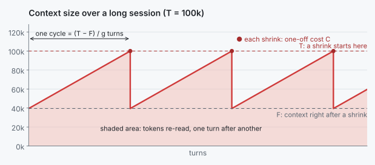

<p align="center"></p>

<h1 align="center">Recontext</h1>

<p align="center">
  <strong>Token-efficient, low-loss context compaction for Claude Code.</strong><br>
  A script prunes the conversation, Haiku distills it, and a recall tool brings back any exact detail later.
</p>

<p align="center">
  <a href="https://github.com/landtml/recontext/releases/latest"></a>
  <a href="LICENSE"></a>
  
  
  
  
  
</p>

<p align="center">
  <a href="#install">Install</a> ·
  <a href="#how-it-works">How it works</a> ·
  <a href="#compatibility">Compatibility</a> ·
  <a href="#configuration">Configuration</a> ·
  <a href="#choosing-the-threshold">Threshold</a> ·
  <a href="#limits">Limits</a> ·
  <a href="CHANGELOG.md">Changelog</a> ·
  <a href="CONTRIBUTING.md">Contributing</a>
</p>

---

- **Your session model is never called.** Built-in compaction has Opus (or whatever you run) re-read the whole
  conversation. Recontext prunes it with code and has Haiku write the summary: measured at 5–22k tokens in and
  8–19 seconds per shrink.
- **Exact facts are copied, not summarized.** Your last messages, failed commands, files and URLs are extracted
  by code word for word, and the most recent messages are kept as they were.
- **Nothing is thrown away.** The full conversation goes to a local archive. The `recall` tool answers questions
  about it with quotes that code checks word for word.
- **Cost stays predictable.** Every Haiku call stays under a token budget (80k by default), below Haiku's
  higher price tier. Larger conversations are split into parts.
- **It can't break compaction.** Any error falls back to Claude Code's built-in compaction.

```
shrink ▸ context 82k / 100k ▓▓▓▓▓▓▓▓░░ · 2 shrinks (Haiku, ~3 s each) · 3 recalls (2 answered)
```
<sup>The status bar above the prompt: context fill against the shrink point, shrinks so far, recalls answered.</sup>

## Why

Claude Code's built-in compaction asks the session's model, often Opus, to read the whole conversation and
summarize it. At a few hundred thousand tokens that one call is expensive. On a subscription it can take a
noticeable share of your usage limit, every time it runs.

Recontext moves the heavy lifting to code and a small model:

| | Built-in compaction | Recontext |
|---|---|---|
| Who reads the old conversation | the session model, all of it | code; Haiku reads a pruned digest |
| Measured example (679k-token session) | one large session-model call | Haiku: 44k tokens in, 2.7k out, 13 s; context 679k → 5.5k |
| Exact details after compaction | only what the summary kept | `recall` fetches them from the archive, with checked quotes |
| If something fails | n/a | code-only handoff, then the built-in compaction |

## How it works

<p align="center"></p>

```
compaction (auto threshold or /compact)
  1. CODE   split the conversation into units: each message, each tool call with its result
  2. CODE   write the archive (one line per message) and a search index, next to the transcript
  3. CODE   build a digest: your words, Claude's words, one line per tool call; bulky tool output dropped,
            a one-line result kept for calls such as tests
            (a very long message is shortened and marked, its full text stays in the archive)
  4. HAIKU  write a short state of work from the digest: goal, next step, decisions and why, what failed.
            Every Haiku call stays under a token budget (default 80k, below Haiku's higher price tier);
            a larger digest is split into up to 6 parts, noted separately, then merged
  5. CODE   check every archive ref (#n, or #k:n for shrink k's archive): refs past an archive's end are
            repaired from the previous handoff or dropped, refs to empty lines are dropped
  6. CODE   add exact facts: your last messages verbatim, failed commands, URLs, agents, any message
            you sent while Claude was working, and the items in play: a ranked slice of the session
            index (every path, file, id and name the session used, merged at each shrink)
  7. CODE   keep the last messages word for word (tool calls paired with their results)
  -> the new context is the handoff plus that tail; the session model is never called

recall(question, leads)   a tool Claude calls when it needs a detail from before a shrink
  0. CODE   exact lookup: a question that names an indexed item is answered from the session index and
            its archive lines, with no model call; if those lines do not answer it, they go first
  1. CODE   search the index: BM25 + exact matches on paths and identifiers + quoted phrases,
            fused by reciprocal rank fusion; neighbours and call/result partners added as evidence
  2. HAIKU  answer from the evidence only, citing each claim with a quote
  3. CODE   check that every cited id exists, every quote appears verbatim, every number is quoted;
            one retry, then the raw passages marked unverified; "not found" when nothing matches,
            after one retry with a wider search
```

The full design, including the options that were considered and rejected, is in
[docs/design.md](docs/design.md).

## Compatibility

| Where | Works |
|---|---|
| Claude Code in the terminal (CLI) | ✅ |
| Claude Code in VS Code | ✅ |
| Claude desktop app, **Code** mode | ✅ |
| Cloud sessions (claude.ai/code) | ❌ unless the plugin is set up in that environment |

Runs on **Linux** and **macOS**. **Windows** is untested.

## Install

At the prompt of a Claude Code terminal session:

```
/plugin marketplace add landtml/recontext
/plugin install shrink@recontext
```

Pick a scope when asked (user scope loads it in every session).
From a shell, in one step: `claude plugin install shrink --marketplace landtml/recontext`
(adds the marketplace first if needed; `--scope user|project|local`, default user).
In the desktop app: click **+** next to the prompt box → **Plugins** → **Add marketplace**
(`landtml/recontext`) → **Add plugin**.

### Turn on automatic shrinking

Recontext does not decide when to compact. Claude Code does, and Recontext replaces what happens at that
moment. Set it up once and every compaction after that is a shrink, with nothing to run by hand.

Add these two lines to `~/.claude/settings.json` (merge them into the existing object if the file has one):

```json
{
  "autoCompactEnabled": true,
  "autoCompactWindow": 133000
}
```

Then start a new session. Settings are read when a session starts, so an open session keeps its old ones.

**What happens from then on:**

1. Claude Code measures the context against the window you set and keeps a reserve of about 33k tokens. With
   `133000`, it starts a compaction at about 100k tokens.
2. Recontext takes over that compaction. Code prunes the conversation into a digest, Haiku writes the state
   of work, and code adds the exact facts and keeps your last messages word for word. Your session model
   (Opus, for example) is not called.
3. The session continues from the handoff. The bar above the prompt counts the shrink, and the `recall` tool
   can fetch any exact detail from the archive later.

**Choosing the window.** `133000` (a 100k threshold) is the recommended value. [Choosing the
threshold](#choosing-the-threshold) shows where it comes from. A larger window compacts less often but sends
more tokens on every request in between. Claude Code treats any value below `100000` as `100000`.

**If it is off.** With `autoCompactEnabled: false`, nothing compacts on its own. At session start the mod shows a notice when auto-compaction is off or the
threshold is above `thresholdWarnAbove` (default `200000`).

**By hand.** You can shrink at any time with `/compact`, optionally with a focus: `/compact the export bug`.
`/shrink now [focus]` does the same from the mod's own command and runs `/compact` once the session is idle.

**Subagents** are shrunk the same way, quietly: no toast and no panel row. Their files carry a `sub…` label.

## What you see

- **A bar above the prompt:** how full the context is against the shrink point, how many shrinks ran (and
  whether Haiku wrote them) and how many recalls answered.
- **`/shrink`:** opens a panel with every shrink (time, automatic or manual, context before → after, Haiku
  tokens, seconds, handoff file) and every recall (question, outcome, tries). It never opens on its own.
- **After a shrink**, Claude Code shows its usual "Compacted chat" line. The message under it starts with
  `# Handoff (this conversation was shrunk by the shrink mod)`, which is how you know the mod handled it.

## Configuration

Claude Code shows these options when you install the mod; the defaults work. To see or change them later,
use the `/config` menu (each option is a row there) or `claude plugin configure shrink` from a shell.

| Option | Default | Meaning |
|---|---|---|
| `mode` | `haiku` | `haiku`: Haiku writes the state of work. `code`: no model call at all at a shrink (facts only). |
| `shrinkModel` | `haiku` | Model alias or id for the state of work and for recall answers. |
| `handoffDir` | *(empty)* | Where handoffs, archives and the index go. Empty: `handoffs/` next to the session transcript. |
| `haikuBudgetTokens` | `80000` | Most input tokens one Haiku call may take (estimated at 2 chars per token). Larger shrinks are split. Keep it under 100000, where Haiku's price rises. |
| `digestChars` | `0` | Off by default. Set it to cap the digest in characters anyway; older lines go first. |
| `stateEffort` | `medium` | Reasoning effort for the state of work (`low`, `medium`, `high`, `xhigh`). |
| `mapEffort` | `medium` | Reasoning effort for the notes on each part of a split shrink. |
| `recallEffort` | `medium` | Reasoning effort for recall answers. |
| `factsBudgetChars` | `14000` | Size limit of the exact facts in the handoff. |
| `tailChars` | `24000` | Size limit of the messages kept word for word. |
| `recallScope` | `project` | `session`: recall searches this session only. `project`: also this project's other sessions. |
| `thresholdWarnAbove` | `200000` | Notice at session start when the auto-compact threshold is missing or above this. |

## Choosing the threshold

The threshold is the context size at which a shrink starts. It is a trade-off. On every turn, Claude Code sends
the whole conversation again. Prompt caching makes the old part cheap, but not free: each cached token is billed
at a tenth of the normal input price, on every turn. A large context therefore costs more on every turn. A
shrink makes the context small again, but each shrink has a one-off cost. This section works out where the two
costs balance.

### The inputs

All values are in tokens and were measured from Claude Code session transcripts, using automatic shrinks only
(77 shrinks, about 5,700 ordinary requests).

| Symbol | What it is | Measured |
|---|---|---|
| F | Context size on the first request after a shrink (median) | 39.5k |
| g | How much the context grows per turn (mean) | 1.8k |
| E | Extra cache writing after a shrink. The six requests after a shrink write 38.3k into the cache, against 6 × 1.77k for six ordinary requests. | 27.7k |
| R | Extra re-reading after a shrink: files opened again and `recall` answers, compared with random points in a session | 0.7k |
| w | Price of writing a token to the cache (1-hour cache: 2× input) relative to reading one (0.1× input) | 20 |

The one-off cost of a shrink, counted in cache reads, is

$$C = w\,(E + R) = 20 \times (27.7\text{k} + 0.7\text{k}) \approx 568\text{k}$$

So one shrink costs about as much as re-reading 568k cached tokens, which is six or seven turns at a 90k context.
The Haiku call that writes the handoff adds about 1% of that, so it is left out.

### The cost per turn

Between two shrinks the context climbs from F to the threshold T, by g per turn. Then it drops back to F.

<p align="center"><picture>
  <source media="(prefers-color-scheme: dark)" srcset="assets/economics-cycle-dark.svg">
  
</picture></p>

One cycle lasts (T − F) / g turns. During a cycle the average context is (F + T) / 2, and the cycle pays for one
shrink. Spread over the cycle, the cost per turn is

$$c(T) = \underbrace{\frac{F + T}{2}}_{\text{reading the context}} + \underbrace{\frac{C\,g}{T - F}}_{\text{shrinks}}$$

The new tokens each turn adds are written to the cache whatever T is, so they do not affect the choice and are
left out. The first term grows with T, because a higher threshold means a larger context on every turn. The
second term shrinks with T, because a higher threshold means fewer shrinks.

### Finding the minimum

The total is lowest where its slope is zero:

$$\frac{dc}{dT} = \frac{1}{2} - \frac{C\,g}{(T - F)^2} = 0 \quad\Longrightarrow\quad T^{*} = F + \sqrt{2\,g\,C}$$

With the measured inputs:

$$T^{*} = 39.5\text{k} + \sqrt{2 \times 1.8\text{k} \times 568\text{k}} = 39.5\text{k} + 45.2\text{k} \approx 85\text{k}$$

<p align="center"><picture>
  <source media="(prefers-color-scheme: dark)" srcset="assets/economics-cost-dark.svg">
  
</picture></p>

The bottom of the curve is flat. Below the minimum the shrink cost takes over: as T gets close to F, there is almost no room to grow between
shrinks, and the cost per turn shoots up. Above the minimum the cost climbs slowly, in a near-straight line.
Compared with the cheapest point:

| Threshold | Turns between shrinks | Cost per turn |
|---|---|---|
| 50k | 6 | +68% |
| 70k | 17 | +4% |
| **85k** | **25** | **lowest** |
| **100k** | **34** | **+2%** |
| 117k | 43 | +8% |
| 167k (what a `200000` window gives) | 71 | +31% |
| 250k | 117 | +77% |
| 300k | 145 | +105% |

### The recommendation

Set `autoCompactWindow` to `133000`. Claude Code keeps a reserve of about 33k, so a shrink starts at 100k.

100k rather than 85k, because the formula prices only tokens. Each shrink also loses some working detail that
`recall` then has to fetch. 100k shrinks about a quarter less often than 85k and costs about 2% more per turn.
The choice also holds up if your inputs differ. T* moves with the square root of g × C, so doubling the shrink
cost only moves the optimum to about 104k, and halving it moves it to about 72k. Both stay close to 100k on a
flat curve.

To fit the value to your own work, measure F and g from your sessions and put them into T* = F + √(2gC). Then set
`autoCompactWindow` to about T* + 33000, but not below `100000`. Run `python3 assets/economics.py` to redraw
the diagrams. The inputs are at the top of the file.

## Files it writes

Everything stays on your machine, in `~/.claude/projects/<project>/handoffs/` (or `handoffDir`):

| File | What |
|---|---|
| `session-handoff_<date>_<session>-<n>.md` | the handoff each shrink installed |
| `archive/<date>_<session>-<n>.txt` | the compacted conversation, one line per message (greppable) |
| `index/*.jsonl` | the search index recall uses |
| `items/<session>.jsonl` | the session index: every exact item with its counts and refs |

It writes no logs or usage data. `claude --debug` shows one trace line per shrink and recall.

The only model calls are the Haiku calls, made through Claude Code's own model access like any other request.

## Limits

- **Facts that appear only in tool output can be missing from the summary.** The digest drops tool output to
  stay small. Recall still finds them, but only if Claude asks.
- **Recall helps only when Claude uses it.** The handoff tells Claude to call `recall` before guessing about
  anything from before a shrink.
- **Search matches whole words** (with light stemming), not parts of words: "pdf" does not find `fpdf2`.
  Leads with exact names (`fpdf2`, a file path, an error class) help.
- **The number check is strict.** An answer that mentions a number found neither in its quotes nor in the
  question fails the check, and after one retry recall returns raw passages, not a guessed number. Evidence
  labels, list numbering and digits inside names (`A7`, `J412`) are not counted as numbers.
- **Exact lookup covers the main session.** A subagent's recall searches its own and the session's archives,
  but answers only through the search and Haiku.

## Uninstall

```sh
claude plugin uninstall shrink@recontext
claude plugin marketplace remove recontext   # optional
```

Built-in compaction takes over again at once. The `handoffs/` folders stay until you delete them.

## Development

```sh
git clone https://github.com/landtml/recontext
cd recontext
claude --plugin-dir .          # run Claude Code with the mod loaded from this folder (edits reload live)
claude plugin test .           # unit and hook tests
claude plugin validate .       # manifest, marketplace file and hooks module
npx -p typescript tsc -p .     # type-check (needs .claude-plugin/types/, written when Claude Code loads the mod)
```

See [CONTRIBUTING.md](CONTRIBUTING.md) for the layout and the rules the code keeps.

## Credits

The retrieval and answer checks (reciprocal rank fusion, evidence expansion, the reader prompt and the citation
gates) are adapted from [governed-rag](https://github.com/landtml/governed-rag).

## License

[MIT](LICENSE)
