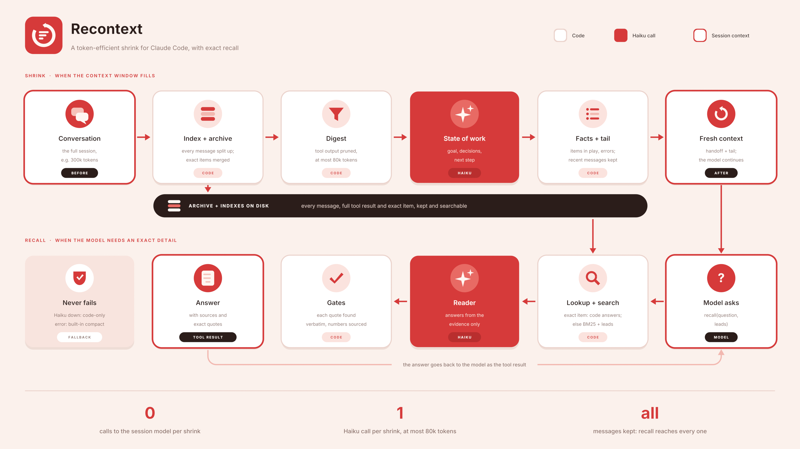
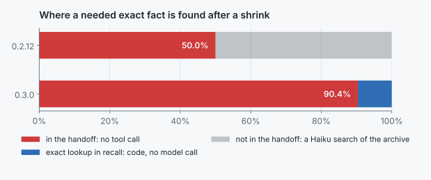
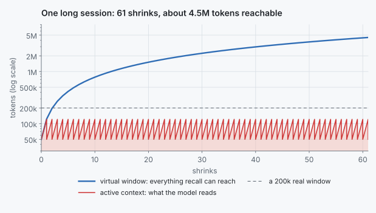
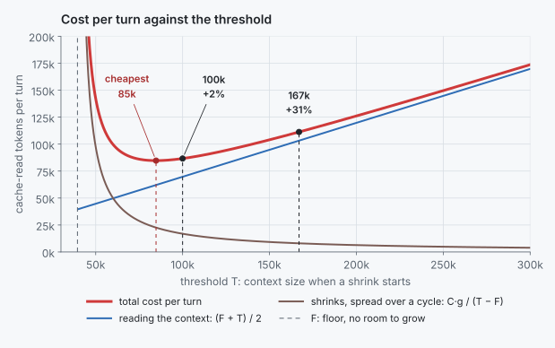

<p align="center"></p>

<h1 align="center">Recontext</h1>

<p align="center">
  <strong>Token-efficient, low-loss context compaction for Claude Code.</strong><br>
  A script prunes the conversation, Haiku distills it, and a recall tool brings back any exact detail later.
</p>

<p align="center">
  <a href="https://github.com/landtml/recontext/releases/latest"></a>
  <a href="LICENSE"></a>
  
  
  
  
  
</p>

<p align="center">
  <a href="#52-installation">Install</a> ·
  <a href="#2-design">Design</a> ·
  <a href="#3-evaluation">Evaluation</a> ·
  <a href="#4-threshold-selection">Threshold</a> ·
  <a href="#56-configuration">Configuration</a> ·
  <a href="#6-limitations">Limitations</a> ·
  <a href="CHANGELOG.md">Changelog</a> ·
  <a href="CONTRIBUTING.md">Contributing</a>
</p>

---

## At a glance

When a Claude Code conversation gets too long, Claude Code compacts it: the session's model reads everything and
writes a summary. Recontext does this job instead, in a more token-efficient way. Code and Haiku write a short handoff,
the session model is never called, and nothing is thrown away: the full conversation stays in a local archive that
Claude can search with the `recall` tool. If anything goes wrong, the built-in compaction runs as before.

```
shrink ▸ context 82k / 100k ▓▓▓▓▓▓▓▓░░ · 2 shrinks (Haiku, ~3 s each) · 3 recalls (2 answered)
```
<sup>The status bar above the prompt: context fill against the shrink point, shrinks so far, recalls answered.</sup>

## Contents

- [1 Introduction](#1-introduction)
- [2 Design](#2-design)
  - [2.1 Overview](#21-overview)
  - [2.2 Shrink pipeline](#22-shrink-pipeline)
  - [2.3 Virtual context window](#23-virtual-context-window)
  - [2.4 Memory tiers](#24-memory-tiers)
  - [2.5 Recall](#25-recall)
- [3 Evaluation](#3-evaluation)
  - [3.1 Metrics](#31-metrics)
  - [3.2 Fact retention](#32-fact-retention)
  - [3.3 Size of the virtual window](#33-size-of-the-virtual-window)
  - [3.4 Recall in live sessions](#34-recall-in-live-sessions)
- [4 Threshold selection](#4-threshold-selection)
  - [4.1 Inputs](#41-inputs)
  - [4.2 Cost model](#42-cost-model)
  - [4.3 Optimum](#43-optimum)
  - [4.4 Recommendation](#44-recommendation)
  - [4.5 Comparison with the built-in default](#45-comparison-with-the-built-in-default)
- [5 Usage](#5-usage)
  - [5.1 Compatibility](#51-compatibility)
  - [5.2 Installation](#52-installation)
  - [5.3 Automatic compaction](#53-automatic-compaction)
  - [5.4 Manual compaction and subagents](#54-manual-compaction-and-subagents)
  - [5.5 Monitoring](#55-monitoring)
  - [5.6 Configuration](#56-configuration)
  - [5.7 Data storage](#57-data-storage)
  - [5.8 Uninstall](#58-uninstall)
- [6 Limitations](#6-limitations)
- [7 Development](#7-development)
- [8 Related work and credits](#8-related-work-and-credits)
- [9 License](#9-license)

## 1 Introduction

Built-in compaction sends the whole conversation to the session's model, often Opus, and asks for a summary.
At a few hundred thousand tokens that single call is expensive. On a subscription it can use a noticeable share
of the usage limit each time it runs, and any exact detail the summary leaves out is gone.

Recontext moves the work to code and a small model. The table compares the two approaches.

| | Built-in compaction | Recontext |
|---|---|---|
| Reads the old conversation | the session model, all of it | code; Haiku reads a pruned digest |
| Measured example (679k-token session) | one large session-model call | Haiku: 44k tokens in, 2.7k out, 13 s; context 679k → 5.5k |
| Exact details after compaction | only what the summary kept | `recall` fetches them from the archive, with checked quotes |
| On failure | n/a | a code-only handoff, then the built-in compaction |

The rest of this document describes the design ([Section 2](#2-design)), measures how much of the session survives
a shrink ([Section 3](#3-evaluation)), derives the recommended compaction threshold
([Section 4](#4-threshold-selection)) and covers installation and use ([Section 5](#5-usage)).

## 2 Design

### 2.1 Overview

<p align="center"></p>

The system has two pipelines. The shrink pipeline runs when Claude Code compacts and replaces the conversation
with a handoff. The recall pipeline runs when Claude needs a detail from before a shrink. Both write to and read
from files on disk next to the session transcript. The full design, including the options that were considered
and rejected, is in [docs/design.md](docs/design.md).

### 2.2 Shrink pipeline

```
compaction (auto threshold or /compact)
  1. CODE   split the conversation into units: each message, each tool call with its result
  2. CODE   write the archive (one line per message) and a search index, next to the transcript
  3. CODE   build a digest: your words, Claude's words, one line per tool call; bulky tool output dropped,
            a one-line result kept for calls such as tests
            (a very long message is shortened and marked, its full text stays in the archive)
  4. HAIKU  write a short state of work from the digest: goal, next step, decisions and why, what failed.
            Every Haiku call stays under a token budget (default 80k, below Haiku's higher price tier);
            a larger digest is split into up to 6 parts, noted separately, then merged
  5. CODE   check every archive ref (#n, or #k:n for shrink k's archive): refs past an archive's end are
            repaired from the previous handoff or dropped, refs to empty lines are dropped
  6. CODE   add exact facts: your last messages verbatim, failed commands, URLs, agents, any message
            you sent while Claude was working, and the items in play: a ranked slice of the session
            index (every path, file, id and name the session used, merged at each shrink)
  7. CODE   keep the last messages word for word (tool calls paired with their results)
  -> the new context is the handoff plus that tail; the session model is never called
```

Only step 4 calls a model. If it fails, the handoff is built from code alone, and if that fails too, Claude
Code's own compaction runs.

### 2.3 Virtual context window

A model can only reason over the tokens in its context window, and Recontext does not make that window larger.
It gives the session a second, much larger store that the model reaches on demand. Following MemGPT
([Packer et al., 2023](https://arxiv.org/abs/2310.08560)), this is called a *virtual context window*, by analogy
with virtual memory in an operating system.

| | Active context | Virtual context window |
|---|---|---|
| Contents | the tokens the model reads on this turn | everything the session has produced, before and after every shrink |
| Size | below the threshold (100k recommended) | unbounded, one archive per shrink |
| Access | direct, on every turn | through `recall`, one tool call per question |
| Cost | re-read on every turn | none until used; a `recall` costs one small Haiku call, or none |

Let A<sub>n</sub> be the active context after shrink n, and B<sub>i</sub> the context size just before shrink i.
Each shrink moves B<sub>i</sub> − A<sub>i</sub> tokens out of the active context into the archive, where they
remain reachable. After n shrinks the virtual window is

$$V_n = A_n + \sum_{i=1}^{n} (B_i - A_i)$$

The active context stays within a band, while V<sub>n</sub> grows by roughly one shrink's worth each time.

### 2.4 Memory tiers

The virtual window is organized in four tiers. As in a computer's memory hierarchy, each tier is larger and
slower to reach than the one above it.

| Tier | Holds | Reached by | Cost to reach |
|---|---|---|---|
| T0 recent | the last messages, word for word | reading | none, already in context |
| T1 handoff | state of work, exact facts, a ranked slice of the session index | reading | none, already in context |
| T2 session index | every path, file, id, command and name the session used, with archive refs | `recall` exact lookup | code only, no model call |
| T3 archive | every message, one line each | `recall` search | one Haiku call under the 80k budget |

### 2.5 Recall

When the model needs something that is not in its active context, it calls `recall`. This plays the role of a
page fault.

```
recall(question, leads)   a tool Claude calls when it needs a detail from before a shrink
  0. CODE   exact lookup: a question that names an indexed item is answered from the session index and
            its archive lines, with no model call; if those lines do not answer it, they go first
  1. CODE   search the index: BM25 + exact matches on paths and identifiers + quoted phrases,
            fused by reciprocal rank fusion; neighbours and call/result partners added as evidence
  2. HAIKU  answer from the evidence only, citing each claim with a quote
  3. CODE   check that every cited id exists, every quote appears verbatim, every number is quoted;
            one retry, then the raw passages marked unverified; "not found" when nothing matches,
            after one retry with a wider search
```

Code first looks the question up in the session index (T2). If an item named in the question is there, its
archive lines are the answer and no model is called. Otherwise code searches the archive (T3) and Haiku answers
from the passages it finds. Code then checks every quote in the answer against the archive. An answer whose
quotes fail the check is returned as the raw passages, marked unverified, so the model never receives an
invented quote.

## 3 Evaluation

### 3.1 Metrics

For a set N of exact items (paths, ids, names, numbers) that the session needs after a shrink, two rates
describe how much of it survives:

$$\text{held} = \frac{|N \cap (\text{T0} \cup \text{T1})|}{|N|} \qquad\qquad \text{reachable} = \frac{|N \cap (\text{T0} \cup \text{T1} \cup \text{T2})|}{|N|}$$

*Held* is the share the model has without calling anything. *Reachable* adds what exact lookup finds without a
model call.

### 3.2 Fact retention

Measured by replaying 91 shrinks with code only:

| | 0.2.12 | 0.3.0 |
|---|---|---|
| held | 50.0% | 90.4% |
| reachable without a model call | 50.0% | 100.0% (1,769 of 1,769) |
| handoff size (median) | baseline | baseline + about 4.4k tokens |

<p align="center"><picture>
  <source media="(prefers-color-scheme: dark)" srcset="assets/recall-tiers-dark.svg">
  
</picture></p>

### 3.3 Size of the virtual window

In the longest session measured, 61 shrinks each took the context from a median of 121k down to 50k. The model
never read more than about 170k tokens at once, yet by the end about 4.5M tokens were reachable, some 22 times a
200k window.

<p align="center"><picture>
  <source media="(prefers-color-scheme: dark)" srcset="assets/recall-window-dark.svg">
  
</picture></p>

### 3.4 Recall in live sessions

Outcomes of 81 `recall` calls in live sessions (all versions), counted from the local log:

| Outcome | Calls | Share |
|---|---|---|
| answered with checked quotes | 67 | 83% |
| raw passages, marked unverified | 8 | 10% |
| nothing found | 6 | 7% |

The median call took about 10 seconds. A hand-graded random sample of 15 answers found 11 fully correct, 3 partly
correct and 1 wrong. None contained an invented fact. Every error was a false "not in the evidence" about
something the archive did hold. With 15 answers the 95% interval for the fully-correct rate is about 45% to 92%,
which is too wide to read as a precise score. These answers predate the exact lookup added in 0.3.0.

Run `python3 assets/recall.py` to redraw the diagrams in this section. The inputs are at the top of the file.

## 4 Threshold selection

The threshold is the context size at which a shrink starts, and choosing it is a trade-off. On every turn
Claude Code sends the whole conversation again. Prompt caching makes the old part cheaper but not free: each
cached token is billed at a tenth of the normal input price, on every turn, so a large context costs more per
turn. A shrink makes the context small again but has a one-off cost. This section finds where the two costs
balance.

### 4.1 Inputs

All values are in tokens, measured from Claude Code session transcripts using automatic shrinks only (77
shrinks, about 5,700 ordinary requests).

| Symbol | Definition | Measured |
|---|---|---|
| F | Context size on the first request after a shrink (median) | 39.5k |
| g | Context growth per turn (mean) | 1.8k |
| E | Extra cache writing after a shrink. The six requests after a shrink write 38.3k into the cache, against 6 × 1.77k for six ordinary requests. | 27.7k |
| R | Extra re-reading after a shrink: files opened again and `recall` answers, compared with random points in a session | 0.7k |
| w | Price of writing a token to the cache (1-hour cache: 2× input) relative to reading one (0.1× input) | 20 |

The one-off cost of a shrink, counted in cache reads, is

$$C = w\,(E + R) = 20 \times (27.7\text{k} + 0.7\text{k}) \approx 568\text{k}$$

One shrink therefore costs about as much as re-reading 568k cached tokens, or six to seven turns at a 90k
context. The Haiku call that writes the handoff adds about 1% to this and is left out.

### 4.2 Cost model

Between two shrinks the context climbs from F to the threshold T by g per turn, then drops back to F.

<p align="center"><picture>
  <source media="(prefers-color-scheme: dark)" srcset="assets/economics-cycle-dark.svg">
  
</picture></p>

One cycle lasts (T − F) / g turns. During a cycle the average context is (F + T) / 2, and the cycle pays for one
shrink. Spread over the cycle, the cost per turn is

$$c(T) = \underbrace{\frac{F + T}{2}}_{\text{reading the context}} + \underbrace{\frac{C\,g}{T - F}}_{\text{shrinks}}$$

The new tokens each turn adds are written to the cache whatever T is, so they do not affect the choice and are
left out. The first term grows with T, because a higher threshold means a larger context on every turn. The
second falls with T, because a higher threshold means fewer shrinks.

### 4.3 Optimum

The total is lowest where its slope is zero:

$$\frac{dc}{dT} = \frac{1}{2} - \frac{C\,g}{(T - F)^2} = 0 \quad\Longrightarrow\quad T^{*} = F + \sqrt{2\,g\,C}$$

With the measured inputs:

$$T^{*} = 39.5\text{k} + \sqrt{2 \times 1.8\text{k} \times 568\text{k}} = 39.5\text{k} + 45.2\text{k} \approx 85\text{k}$$

<p align="center"><picture>
  <source media="(prefers-color-scheme: dark)" srcset="assets/economics-cost-dark.svg">
  
</picture></p>

The curve is flat near its minimum. Below it the shrink term dominates: as T approaches F there is almost no
room to grow between shrinks, and the cost per turn rises steeply. Above it the cost climbs slowly, almost in a
straight line. Relative to the cheapest point:

| Threshold | Turns between shrinks | Cost per turn |
|---|---|---|
| 50k | 6 | +68% |
| 70k | 17 | +4% |
| **85k** | **25** | **lowest** |
| **100k** | **34** | **+2%** |
| 117k | 43 | +8% |
| 167k (what a `200000` window gives) | 71 | +31% |
| 250k | 117 | +77% |
| 300k | 145 | +105% |

### 4.4 Recommendation

Set `autoCompactWindow` to `133000`. Claude Code keeps a reserve of about 33k, so a shrink starts at 100k.

The recommendation is 100k rather than 85k because the formula prices only tokens. Each shrink also loses some
working detail that `recall` then has to fetch. 100k shrinks about a quarter less often than 85k and costs about
2% more per turn. The choice is also robust to different inputs. T* moves with the square root of g × C, so
doubling the shrink cost moves the optimum only to about 104k, and halving it moves it to about 72k. Both lie
close to 100k on a flat curve.

To fit the value to your own work, measure F and g from your sessions and compute T* = F + √(2gC). Then set
`autoCompactWindow` to about T* + 33000, and no lower than `100000`. Run `python3 assets/economics.py` to redraw
the diagrams. The inputs are at the top of the file.

### 4.5 Comparison with the built-in default

Claude Code's default 200k window compacts at about 167k. Using the same cost model with one measured built-in
compaction (a 3.4k summary that left an 18k context), and pricing the summary's Opus output at about 50 cache
reads per token, the default comes to the following:

| Setup | Cost per turn, in cache-read tokens |
|---|---|
| Built-in compaction at 167k (default) | 98k–116k |
| Recontext at 100k (recommended) | 87k |

The range for built-in comes from one unknown: whether the summary request reads the conversation from the
cache (low end) or pays full input price (high end). The comparison rests on a single measured built-in
compaction, so treat it as a range, not a precise figure. It also leaves three things out: details the summary
drops and the work of finding them again, the share of a subscription usage limit that an Opus summary uses, and
any difference in answer quality at large contexts.

## 5 Usage

### 5.1 Compatibility

| Environment | Supported |
|---|---|
| Claude Code in the terminal (CLI) | ✅ |
| Claude Code in VS Code | ✅ |
| Claude desktop app, **Code** mode | ✅ |
| Cloud sessions (claude.ai/code) | ❌ unless the plugin is set up in that environment |

Recontext runs on Linux and macOS. Windows is untested.

### 5.2 Installation

At the prompt of a Claude Code terminal session:

```
/plugin marketplace add landtml/recontext
/plugin install shrink@recontext
```

Pick a scope when asked; user scope loads the plugin in every session. From a shell, the same can be done in one
step with `claude plugin install shrink --marketplace landtml/recontext`, which adds the marketplace first if
needed (`--scope user|project|local`, default user). In the desktop app, click **+** next to the prompt box, then
**Plugins**, **Add marketplace** (`landtml/recontext`) and **Add plugin**.

### 5.3 Automatic compaction

Recontext does not decide when to compact. Claude Code makes that decision, and Recontext replaces what happens
at that point. Once set up, every compaction is a shrink and nothing needs to be run by hand.

Add these two lines to `~/.claude/settings.json`, merging them into the existing object if the file has one:

```json
{
  "autoCompactEnabled": true,
  "autoCompactWindow": 133000
}
```

Then start a new session. Settings are read when a session starts, so an open session keeps its old ones.

From then on:

1. Claude Code measures the context against the configured window and keeps a reserve of about 33k tokens.
   With `133000`, it starts a compaction at about 100k tokens.
2. Recontext takes over the compaction. Code prunes the conversation into a digest, Haiku writes the state of
   work, and code adds the exact facts and keeps the last messages word for word. The session model (Opus, for
   example) is not called.
3. The session continues from the handoff. The bar above the prompt counts the shrink, and `recall` can fetch
   any exact detail from the archive later.

`133000` (a 100k threshold) is the recommended window; [Section 4](#4-threshold-selection) explains
why. A larger window compacts less often but sends more tokens on every request in between. Claude Code treats
any value below `100000` as `100000`.

With `autoCompactEnabled: false`, nothing compacts on its own. At session start the mod shows a notice when
auto-compaction is off or the threshold is above `thresholdWarnAbove` (default `200000`).

### 5.4 Manual compaction and subagents

A shrink can be started at any time with `/compact`, optionally with a focus, as in `/compact the export bug`.
`/shrink now [focus]` does the same from the mod's own command and runs `/compact` once the session is idle.

Subagents are shrunk the same way, without a toast or a panel row. Their files carry a `sub…` label.

### 5.5 Monitoring

- **Status bar.** The bar above the prompt shows context fill against the shrink point, the number of shrinks
  (and whether Haiku wrote them) and the number of recalls answered.
- **`/shrink` panel.** Lists every shrink (time, automatic or manual, context before → after, Haiku tokens,
  seconds, handoff file) and every recall (question, outcome, tries). It opens only when asked.
- **Compaction notice.** After a shrink Claude Code shows its usual "Compacted chat" line. The message under it
  starts with `# Handoff (this conversation was shrunk by the shrink mod)`, which confirms the mod handled it.

### 5.6 Configuration

Claude Code shows these options when the mod is installed, and the defaults work. To view or change them later,
use the `/config` menu (one row per option) or `claude plugin configure shrink` from a shell.

| Option | Default | Meaning |
|---|---|---|
| `mode` | `haiku` | `haiku`: Haiku writes the state of work. `code`: no model call at all at a shrink (facts only). |
| `shrinkModel` | `haiku` | Model alias or id for the state of work and for recall answers. |
| `handoffDir` | *(empty)* | Where handoffs, archives and the index go. Empty: `handoffs/` next to the session transcript. |
| `haikuBudgetTokens` | `80000` | Most input tokens one Haiku call may take (estimated at 2 chars per token). Larger shrinks are split. Keep it under 100000, where Haiku's price rises. |
| `digestChars` | `0` | Off by default. Set it to cap the digest in characters anyway; older lines go first. |
| `stateEffort` | `medium` | Reasoning effort for the state of work (`low`, `medium`, `high`, `xhigh`). |
| `mapEffort` | `medium` | Reasoning effort for the notes on each part of a split shrink. |
| `recallEffort` | `medium` | Reasoning effort for recall answers. |
| `factsBudgetChars` | `14000` | Size limit of the exact facts in the handoff. |
| `tailChars` | `24000` | Size limit of the messages kept word for word. |
| `recallScope` | `project` | `session`: recall searches this session only. `project`: also this project's other sessions. |
| `thresholdWarnAbove` | `200000` | Notice at session start when the auto-compact threshold is missing or above this. |

### 5.7 Data storage

All files stay on the local machine, in `~/.claude/projects/<project>/handoffs/` (or `handoffDir`):

| File | Contents |
|---|---|
| `session-handoff_<date>_<session>-<n>.md` | the handoff each shrink installed |
| `archive/<date>_<session>-<n>.txt` | the compacted conversation, one line per message (greppable) |
| `index/*.jsonl` | the search index recall uses |
| `items/<session>.jsonl` | the session index: every exact item with its counts and refs |

The mod writes no logs or usage data. `claude --debug` shows one trace line per shrink and recall. The only
model calls are the Haiku calls, made through Claude Code's own model access like any other request.

### 5.8 Uninstall

```sh
claude plugin uninstall shrink@recontext
claude plugin marketplace remove recontext   # optional
```

Built-in compaction takes over again immediately. The `handoffs/` folders remain until you delete them.

## 6 Limitations

- **The real window is unchanged.** The model still reasons over the active context only. A fact in the archive
  helps only once `recall` brings it in, and Claude has to know to ask. The handoff instructs Claude to call
  `recall` before guessing about anything from before a shrink.
- **Facts that appear only in tool output can be missing from the summary.** The digest drops tool output to
  stay small. Recall still finds such facts, but only when asked.
- **Recall has a cost.** A search takes one Haiku call and a few seconds, and the answer then occupies space in
  the active context.
- **Retrieval is the weak point.** Errors come from not finding the right passages, not from invented facts. A
  question with no distinctive word or name is the hardest case.
- **Search matches whole words** (with light stemming), not parts of words: "pdf" does not find `fpdf2`. Leads
  with exact names (`fpdf2`, a file path, an error class) help.
- **The number check is strict.** An answer that mentions a number found neither in its quotes nor in the
  question fails the check, and after one retry recall returns raw passages rather than a guessed number.
  Evidence labels, list numbering and digits inside names (`A7`, `J412`) are not counted as numbers.
- **Exact lookup covers the main session only.** A subagent's recall searches its own and the session's
  archives, but answers only through the search and Haiku.

## 7 Development

```sh
git clone https://github.com/landtml/recontext
cd recontext
claude --plugin-dir .          # run Claude Code with the mod loaded from this folder (edits reload live)
claude plugin test .           # unit and hook tests
claude plugin validate .       # manifest, marketplace file and hooks module
npx -p typescript tsc -p .     # type-check (needs .claude-plugin/types/, written when Claude Code loads the mod)
```

See [CONTRIBUTING.md](CONTRIBUTING.md) for the layout and the rules the code keeps.

## 8 Related work and credits

The virtual context window follows MemGPT ([Packer et al., 2023](https://arxiv.org/abs/2310.08560)). The
retrieval and answer checks (reciprocal rank fusion, evidence expansion, the reader prompt and the citation
gates) are adapted from [governed-rag](https://github.com/landtml/governed-rag).

## 9 License

[MIT](LICENSE)
